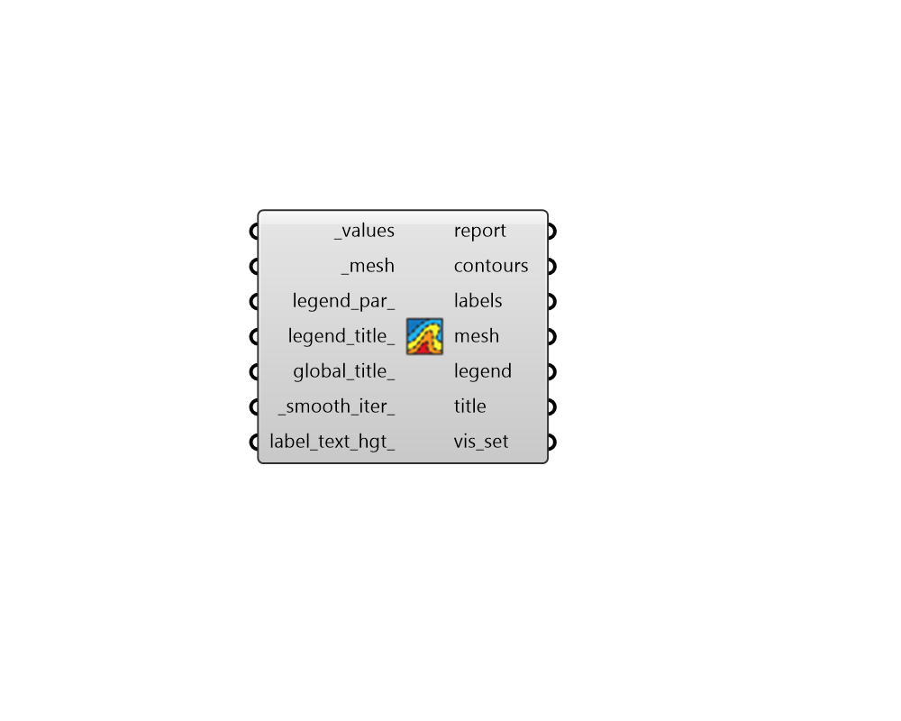

## Contour Mesh

 - [[source code]](https://github.com/ladybug-tools/ladybug-grasshopper/blob/master/ladybug_grasshopper/src//LB%20Contour%20Mesh.py)

Create a contoured visualization of any mesh and corresponding numerical dataset. 

This component works similar in principle to the "LB Mesh Threshold Selector" except that it is intended to produce multiple contours (instead of one contour defined by a single threshold). 

It includes options for lableing each contour with its threshold value and smoothing the contours for a more appealing visualization. 

If the output of this component is not as smooth or visually appealing as expected, this is often because there are not enough faces in the input mesh to draw a clear set of contours. Therefore lowering the mesh grid size used for the study or increasing the smoothness of mesh parameters will often yeild a better contour result. Alternatively, connecting "LB Legend Parameters" with a lower seg_count_ can produce fewer contours, which may provide the algorithm with enough data to draw the contours cleanly. 

#### Inputs
* ##### values [Required]
A list of numbers that correspond to either the number of faces or vertices of the _mesh. 
* ##### mesh [Required]
A Mesh for which contours will be derived. 
* ##### legend_par 
Ladybug LegendParameters to be used to customize the min/max and quantity of contours to draw. These can also be used to customize the decimal count of the contours. If None, default legend parameters are used. (DefaultL None). 
* ##### legend_title 
A text string for Legend title. Typically, the units of the data are used here but the type of data might also be used. Default is an empty string. 
* ##### global_title 
A text string to label the entire mesh.  It will be displayed in the lower left of the result mesh. Default is for no title. 
* ##### smooth_iter 
The number of times that the contours will be smoothed. Smoothing can make the contours more visually appealing but excessive smoothing can cause contours to be far from the real threshold in the mesh. Set to zero to not perform any smoothing. (Default: 0). 
* ##### label_text_hgt 
An optional number to set the size of the contour text labeld in model units. Set to zero to completely remove labels from the resulting output. Default is set to a fraction of the average contour length. 

#### Outputs
* ##### report
Reports, errors, warnings, etc. 
* ##### contours
A data tree (aka. list of lists) where each sub-list represents contours associated with a specific threshold. Contours are composed of Rhino Polyline and Line objects. 
* ##### labels
A data tree of of text objects that denote the numerical value associated with each contour. The sub-lists of this data tree match the contours. 
* ##### mesh
The input _mesh that has been colored with results. 
* ##### legend
Geometry representing the legend for the mesh. 
* ##### title
A text object for the global_title. 
* ##### vis_set
A VisualizationSet object for drawing a detailed version of the heatmap in the Rhino scene. This can be connected to the "LB Preview Visualization Set" component to display this version of the heatmap in Rhino. 